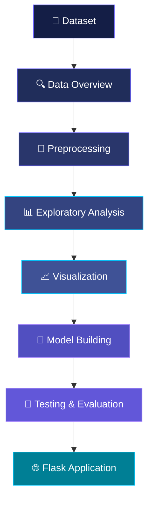

 <div align="center">


### ✨ Data Analysis • Machine Learning • Visualization • Flask

**Turning Data into Insights Through Python and Web Development**

<br>

<a href="https://github.com/AbdalrahmanOthman01/AIS4_S1_3">

</a>
<a href="assets/DEPI%20Presentation.pdf">

</a>
<a href="assets/DEPI_Demo.mp4">

</a>

<br><br>


<br>


</div>

---

## 📌 Table of Contents

<details open>
<summary><b>🧭 Navigate Through the Project</b></summary>

<br>

| Section | Section | 
|:--|:--|
| [🚀 Overview](#-project-overview) | [✨ Features](#-key-features) |
| [🛠️ Tech Stack](#️-technology-stack) | [📁 Structure](#-project-structure) |
| [👥 Our Team](#-team-members--contributions) | [🎬 Demo & Presentation](#-project-demo--presentation) |
| [⚙️ Installation](#️-installation--setup) | [▶️ Run the Application](#️-running-the-application) |
| [📊 Workflow](#-data-analysis-workflow) | [🤝 Contributing](#-contributing) |
| [📜 License](#-license) | |

</details>

---

## 🚀 Project Overview

<table>
<tr>
<td>

**AIS4_S1_3** is a collaborative project developed by the **Digital Egypt Pioneers Initiative (DEPI) team**.

The project brings together data analysis, visualization, machine learning workflows, and web development in a Python-based application powered by Flask.

From exploring structured datasets to presenting analytical results through a web interface, the project demonstrates how different stages of a data workflow can be organized into one integrated application.

</td>
</tr>
</table>

<div align="center">

| 📊 Data Analysis | 🧠 Model Development | 🌐 Web Application |
|:---:|:---:|:---:|
| Explore and prepare data | Train and evaluate models | Present functionality through Flask |

</div>

### 🎯 Project Goals

- Transform raw data into structured, usable information.
- Explore patterns, distributions, and relationships in datasets.
- Develop and evaluate machine learning models where applicable.
- Communicate analytical findings through visualizations.
- Integrate project components into a web application.

---

## ✨ Key Features

<table>
<tr>
<td width="50%" valign="top">

### 📊 Exploratory Data Analysis

Explore the dataset using Jupyter Notebooks, inspect its structure, and investigate patterns and feature relationships.

</td>
<td width="50%" valign="top">

### 📈 Data Visualization

Represent analytical findings through charts and graphical visualizations to make patterns easier to understand.

</td>
</tr>
<tr>
<td width="50%" valign="top">

### 🧠 Model Development

Organize the model-building, training, testing, and evaluation workflow.

</td>
<td width="50%" valign="top">

### 🌐 Flask Integration

Connect project functionality to a web interface for user interaction and presentation.

</td>
</tr>
<tr>
<td colspan="2" valign="top">

### 🗂️ Organized Project Components

Separate notebooks, model resources, frontend assets, application templates, and supporting utilities into dedicated directories.

</td>
</tr>
</table>

---

## 🛠️ Technology Stack

<div align="center">

### Core Technologies


### Data Science & Analysis


</div>

| Technology | Role |
|:--|:--|
| Python | Core application and data processing |
| Pandas | Data manipulation and preprocessing |
| NumPy | Numerical operations |
| Matplotlib | Data visualization |
| Flask | Backend web framework |
| Jupyter Notebook | Data exploration and experimentation |
| HTML / CSS / JavaScript | Frontend technologies, where applicable |
| Git / GitHub | Version control and collaboration |

---

## 📁 Project Structure

```text
AIS4_S1_3/
│
├── assets/
│   ├── DEPI Presentation.pdf
│   └── DEPI_Demo.mp4
│
├── Notebooks/
│   └── Data exploration and analysis
│
├── models/
│   └── Model resources
│
├── static/
│   └── CSS, JavaScript, and images
│
├── templates/
│   └── HTML templates
│
├── app.py
├── eda_utils.py
├── requirements.txt
├── data.rar
└── README.md
```

<details>
<summary><b>📂 Explore the directory guide</b></summary>

| File / Directory | Description |
|:--|:--|
| `assets/` | Presentation slides and demo video |
| `Notebooks/` | Data exploration and analysis notebooks |
| `models/` | Model files and related resources |
| `static/` | Static web assets |
| `templates/` | HTML templates for Flask |
| `app.py` | Main application entry point |
| `eda_utils.py` | Data analysis utility functions |
| `requirements.txt` | Python dependencies |
| `data.rar` | Compressed dataset archive |
| `README.md` | Project documentation |

</details>

---

## 👥 Team Members & Contributions

<div align="center">

| Team Member | Contribution | Focus Area |
|:--|:--|:--|
| **Mohamed Omar** | Data Overview & Preprocessing | Data Preparation |
| **Habiba Maged** | Data Visualization | Visual Analytics |
| **Esraa Yaser** | Model Building, Training & Testing | Machine Learning |
| **Abdalrahman Hossam** | Application Deployment | Web Application |

</div>

### 🤝 One Team. Different Strengths. Shared Results.

Each team member contributed to a different stage of the project workflow, bringing together data preparation, visualization, model development, and application deployment.

---

## 🎬 Project Demo & Presentation

<div align="center">

### 📑 Project Presentation

<a href="assets/DEPI%20Presentation.pdf">

</a>

Explore the project presentation, objectives, workflow, and key components.

<br><br>

### 🎥 Application Demo

<a href="assets/DEPI_Demo.mp4">

</a>

Watch the recorded demonstration of the application.

</div>

> **Note:** Both files must exist in `assets/` with the exact filenames shown above for the links to work.

---

## ⚙️ Installation & Setup

Follow these steps to prepare the project on your local machine.

### 1. Clone the Repository

```bash
git clone https://github.com/AbdalrahmanOthman01/AIS4_S1_3.git
cd AIS4_S1_3
```

### 2. Create a Virtual Environment

```bash
python -m venv venv
```

### 3. Activate the Environment

**Windows — PowerShell**

```powershell
.\venv\Scripts\Activate.ps1
```

**Windows — Command Prompt**

```bat
venv\Scripts\activate.bat
```

**Linux / macOS**

```bash
source venv/bin/activate
```

### 4. Install Dependencies

```bash
python -m pip install --upgrade pip
pip install -r requirements.txt
```

### 5. Prepare the Dataset

If the application requires `data.rar`, extract it using a compatible archive utility and place the resulting files in the locations expected by the application.

---

## ▶️ Running the Application

After installing the dependencies and preparing the required files, run:

```bash
python app.py
```

Open your browser and visit:

<div align="center">

<a href="http://127.0.0.1:5000/">

</a>

</div>

**Local URL:** `http://127.0.0.1:5000/`

The application address may differ if the host or port is configured differently in `app.py`.

---

## 📊 Data Analysis Workflow

<div align="center">



</div>

The workflow illustrates how data preparation and analysis can connect with model evaluation and web application delivery. The exact steps depend on the implementation in the repository.

---

## 🤝 Contributing

Improvements and contributions are welcome.

<details>
<summary><b>Step 1 — Fork the Repository</b></summary>

Create your own fork of this repository on GitHub.

</details>

<details>
<summary><b>Step 2 — Create a Feature Branch</b></summary>

```bash
git checkout -b feature/your-feature
```

</details>

<details>
<summary><b>Step 3 — Commit Your Changes</b></summary>

```bash
git add .
git commit -m "Describe your changes"
```

</details>

<details>
<summary><b>Step 4 — Push Your Branch</b></summary>

```bash
git push origin feature/your-feature
```

</details>

<details>
<summary><b>Step 5 — Open a Pull Request</b></summary>

Open a pull request with a clear description of your changes and their purpose.

</details>

---

## 📜 License

This project is intended to use the **MIT License**. Refer to the repository's `LICENSE` file for the applicable license terms.

Learn more about the [MIT License](https://opensource.org/licenses/MIT).

---

<div align="center">


### 💜 AIS4_S1_3 — DEPI Team Project

**Data Analysis · Machine Learning · Visualization · Flask**

*Built through collaboration, experimentation, and data-driven thinking.*

<br>

<a href="https://github.com/AbdalrahmanOthman01/AIS4_S1_3">

</a>

<br><br>

<sub>Digital Egypt Pioneers Initiative · Team Project</sub>

</div>
